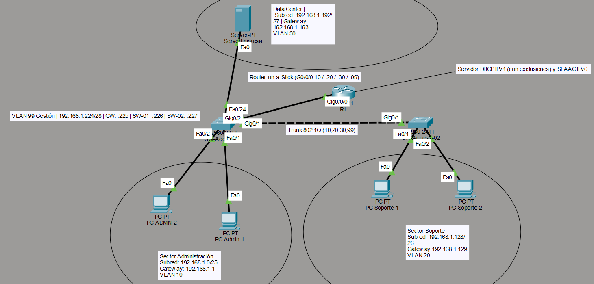
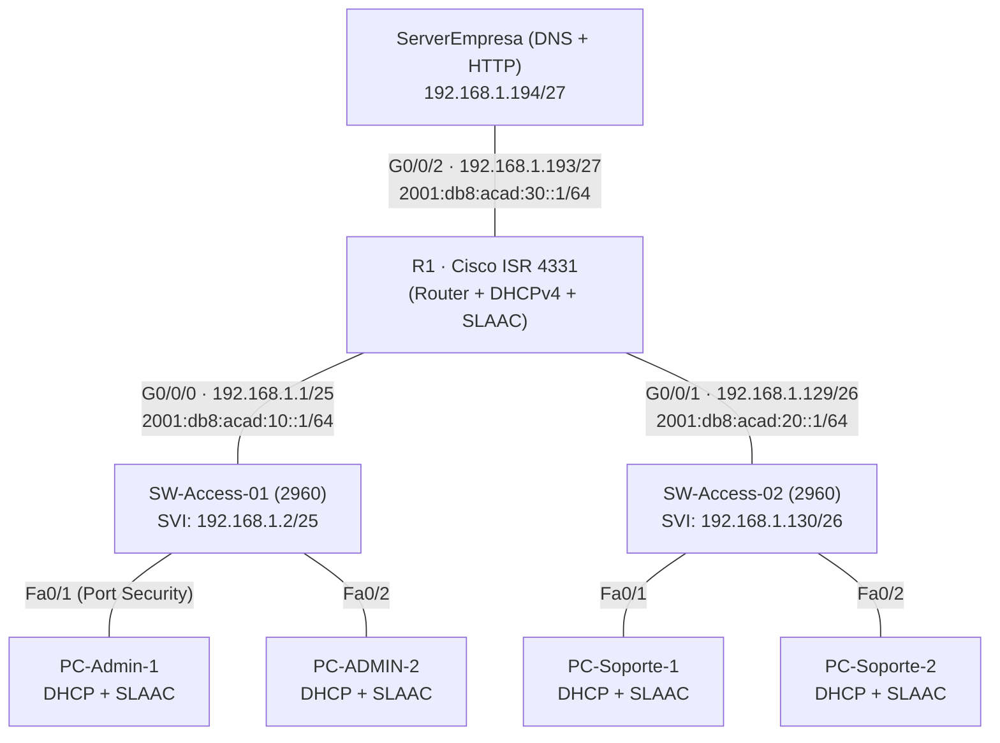

# Red corporativa Cisco: evolución de CCNA ITN a una arquitectura VLAN y Router-on-a-Stick

Proyecto de red corporativa desarrollado en Cisco Packet Tracer con un router ISR 4331, dos switches Catalyst 2960-24TT, cuatro PCs y un servidor interno. El laboratorio conserva una primera versión (v1, nivel CCNA ITN) y documenta su evolución a una segunda arquitectura (v2, contenidos de CCNA SRWE): segmentación mediante VLAN, enlaces trunk 802.1Q, Router-on-a-Stick, red dedicada de gestión y conectividad Dual-Stack.

Es el segundo proyecto que subo, después del [laboratorio de Mini ISP con MikroTik](https://github.com/idersalto3/mikrotik-mini-isp-lab). Lo desarrollé para llevar a la práctica los fundamentos de redes y seguir ampliándolo a medida que avanzo con Cisco Networking Academy.

## Por qué lo armé

Soy técnico en redes y, mientras repasaba los 17 módulos de CCNA 1, me di cuenta de que una cosa es entender la teoría en un apunte (cómo funciona VLSM, qué hace ARP, cómo se maneja un switch con la tabla MAC, para qué sirve el Default Gateway en una SVI) y otra muy distinta es sentarte frente a la consola en blanco y hacerlo.

Armé esta topología para juntar en un solo escenario casi todo lo que vi en ITN y ver cómo se relacionan las capas de punta a punta: desde el cableado y el bloqueo de una MAC intrusa en un puerto, hasta el ruteo entre subredes de distinto tamaño y que una PC abra un sitio interno por nombre.


---

## Evolución v2 — Refactorización a arquitectura empresarial (CCNA SRWE)

<kbd>v1 · CCNA ITN</kbd> → <kbd>v2 · CCNA SRWE</kbd>

La versión 2 transforma la topología inicial, que conectaba cada sector a una interfaz física distinta del router, en una arquitectura lógica segmentada. Se implementó **Router-on-a-Stick** sobre un único enlace físico entre R1 y SW-Access-01, cuatro VLAN y trunks 802.1Q entre los equipos de infraestructura.

> [!IMPORTANT]
> La v1 se conserva como punto de partida y continúa documentada más abajo. La v2 es una evolución del mismo laboratorio, no un reemplazo de la versión original. Las credenciales y direcciones utilizadas pertenecen exclusivamente a Packet Tracer.

### Resumen del cambio v1 → v2

| Aspecto | v1 · Base ITN | v2 · Arquitectura SRWE |
|---|---|---|
| Enlace router-switch | Tres enlaces físicos, uno por sector | Un enlace trunk por `R1 G0/0/0`, con cuatro subinterfaces |
| Segmentación | Sectores separados por enlaces físicos y puertos en VLAN 1 | VLAN 10, 20, 30 y 99 |
| Interconexión de switches | Sin trunk inter-switch en la versión final v1 | Trunk 802.1Q entre `SW-Access-01` y `SW-Access-02` |
| Gestión | SVIs sobre VLAN 1 | VLAN 99 dedicada, VLAN 1 apagada |
| Routing | Una interfaz física por subred | Router-on-a-Stick y routing inter-VLAN |
| Servicios | DHCPv4, SLAAC IPv6, DNS y HTTP | Servicios conservados y adaptados a la nueva segmentación |

### Topología lógica v2



Archivo de simulación: [`red-corporativa-v2.pkt`](packet-tracer/red-corporativa-v2.pkt).

### Matriz de direccionamiento v2

| VLAN | Nombre | Subred IPv4 | Máscara | Prefijo IPv6 | Gateway en R1 | Dispositivos / direcciones |
|---:|---|---|---|---|---|---|
| 10 | `ADMIN` | `192.168.1.0/25` | `255.255.255.128` | `2001:db8:acad:10::/64` | `192.168.1.1` / `2001:db8:acad:10::1` | PC-Admin-1 y PC-ADMIN-2 por DHCPv4 y SLAAC |
| 20 | `SOPORTE` | `192.168.1.128/26` | `255.255.255.192` | `2001:db8:acad:20::/64` | `192.168.1.129` / `2001:db8:acad:20::1` | PC-Soporte-1 y PC-Soporte-2 por DHCPv4 y SLAAC |
| 30 | `SERVIDORES` | `192.168.1.192/27` | `255.255.255.224` | `2001:db8:acad:30::/64` | `192.168.1.193` / `2001:db8:acad:30::1` | ServerEmpresa: `192.168.1.194`, DNS y HTTP |
| 99 | `GESTION` | `192.168.1.224/28` | `255.255.255.240` | `2001:db8:acad:99::/64` | `192.168.1.225` / `2001:db8:acad:99::1` | SW-Access-01: `192.168.1.226`; SW-Access-02: `192.168.1.227` |

Las subinterfaces de R1 utilizan `fe80::1` como dirección IPv6 link-local. Los dos switches utilizan `192.168.1.225` como gateway de gestión. Sus SVI de VLAN 1 quedaron en `shutdown`.

### Mapeo de puertos v2

| Equipo / puerto | Conectado a | Modo / VLAN | Función |
|---|---|---|---|
| R1 `G0/0/0` | SW-Access-01 `Gi0/2` | Trunk 802.1Q | Router-on-a-Stick: VLAN 10, 20, 30 y 99 |
| SW-Access-01 `Gi0/1` | SW-Access-02 `Gi0/1` | Trunk 802.1Q | Transporte de VLAN entre switches |
| SW-Access-01 `Fa0/1–Fa0/2` | PCs de Administración | Access VLAN 10 | Puestos de Administración |
| SW-Access-01 `Fa0/24` | ServerEmpresa `Fa0` | Access VLAN 30 | Servicios DNS y HTTP |
| SW-Access-02 `Fa0/1–Fa0/2` | PCs de Soporte | Access VLAN 20 | Puestos de Soporte |

Los trunks se configuraron manualmente en ambos extremos, con la lista permitida `10,20,30,99` y negociación DTP deshabilitada mediante `nonegotiate`. La interfaz física `G0/0/0` de R1 transporta las cuatro redes mediante las subinterfaces `.10`, `.20`, `.30` y `.99`. Las interfaces físicas `G0/0/1` y `G0/0/2` quedaron administrativamente apagadas en la topología v2.

### Qué se conservó y qué cambió

- Se conservaron los pools DHCPv4 y las exclusiones existentes en R1; no fue necesario recrearlos para la migración.
- Se mantuvieron los prefijos IPv4 de Administración, Soporte y Servidores. Se agregó el bloque `192.168.1.224/28` para gestión.
- Se mantuvieron los prefijos IPv6 por sector y se trasladó el gateway a las subinterfaces correspondientes.
- ServerEmpresa conserva la IP fija `192.168.1.194` y los servicios DNS/HTTP para `www.ider.com`.
- La administración de ambos switches pasó a VLAN 99, con SSHv2 y direcciones independientes.

### Verificación de la versión 2

Las siguientes pruebas fueron realizadas durante la migración y quedaron registradas en el post-mortem:

| Prueba | Resultado observado |
|---|---|
| Subinterfaces en R1 | `G0/0/0.10`, `.20`, `.30` y `.99` en `up/up` |
| Interfaces físicas no utilizadas | `G0/0/1` y `G0/0/2` en `administratively down/down` |
| Trunks | VLAN 10, 20, 30 y 99 en forwarding |
| DHCPv4 en Administración y Soporte | La asignación volvió a funcionar después de corregir VLAN locales y puertos de acceso en SW-Access-02 |
| DNS y conectividad al servidor | Desde PC-Soporte-1, `ping www.ider.com` resolvió `192.168.1.194`: 4 enviados, 4 recibidos, 0% de pérdida, menos de 1 ms y TTL=127 |
| Gestión SSH | Desde PC-Soporte-1 se inició sesión en `192.168.1.226` y `192.168.1.227`; ambos switches mostraron su banner y prompt correspondiente |

> [!NOTE]
> La prueba `ping www.ider.com` confirma resolución DNS y conectividad IP/ICMP hasta el servidor. No se toma por sí sola como evidencia de una prueba HTTP desde el navegador. Del mismo modo, la salida de `show ipv6 interface brief` confirma las direcciones en las subinterfaces del router; conviene agregar una prueba de SLAAC y conectividad IPv6 desde una PC como evidencia de extremo a extremo.

### Troubleshooting real — Post-mortem de la migración

La migración no fue lineal. Estos fueron los incidentes más importantes y cómo se aislaron.

#### 1. Pérdida de SSH durante el recableado

- **Síntoma:** desde PC-Soporte-1, el intento de SSH a `192.168.1.2` devolvía `remote host not responding` después de unir los switches y desconectar `R1 G0/0/1`.
- **Diagnóstico:** la comunicación de Capa 2 entre switches seguía operativa en VLAN 1. El problema estaba en Capa 3: PC-Soporte-1 necesitaba llegar a otra subred mediante su gateway `192.168.1.129`, que había quedado desconectado al retirar el enlace físico de R1.
- **Causa raíz:** pérdida temporal del gateway de Capa 3 durante el recableado; no era inicialmente un problema de trunk.
- **Solución y aprendizaje:** continuar la migración desde consola, es decir, con acceso out-of-band, para no depender de una sesión SSH que puede cortarse al cambiar enlaces, VLAN o SVIs.

#### 2. Comando aplicado en el equipo equivocado

- **Síntoma:** IOS rechazó `interface GigabitEthernet0/0/0`.
- **Diagnóstico:** la sesión seguía abierta en un Catalyst 2960, no en el ISR 4331. En el switch los uplinks se identifican como `Gig0/1` y `Gig0/2`; la interfaz de tres niveles `Gig0/0/0` pertenece al router.
- **Causa raíz:** contexto de CLI distinto del que se había supuesto.
- **Solución y aprendizaje:** verificar hostname, prompt y modelo de equipo antes de ejecutar cambios. No alcanza con recordar un comando: hay que confirmar en qué dispositivo se está trabajando.

#### 3. Trunk inter-switch sin operación correcta

- **Síntoma:** el enlace entre SW-Access-01 y SW-Access-02 permanecía visualmente en ámbar.
- **Diagnóstico:** `show interfaces trunk` no mostraba un trunk operativo en SW-Access-02.
- **Causa raíz:** un extremo estaba configurado como trunk con `nonegotiate`, mientras el otro permanecía en modo access por defecto.
- **Solución y aprendizaje:** configurar explícitamente el trunk en ambos extremos, con la misma lista de VLAN permitidas. La configuración de un enlace trunk debe coincidir en los dos switches.

#### 4. Dirección IPv6 duplicada al migrar a subinterfaces

- **Síntoma:** al asignar `2001:db8:acad:30::1/64` a `G0/0/0.30`, IOS informó `%IPv6-DUP_ADDR_CONFLICT`.
- **Diagnóstico:** `show ipv6 interface brief` mostró que la dirección seguía presente en la interfaz física anterior `G0/0/2`. El intento de limpiar direcciones mediante `no ipv6 address` dentro de un `interface range` no eliminó esa configuración heredada en Packet Tracer.
- **Causa raíz:** la misma dirección IPv6 quedó configurada en la interfaz física de la v1 y en la nueva subinterfaz.
- **Solución y aprendizaje:** eliminar explícitamente la dirección de `G0/0/2` y asignarla a `G0/0/0.30`. Después de una migración, verificar las direcciones residuales antes de reutilizarlas.

#### 5. DHCP fallaba en Soporte, pero funcionaba en Administración

- **Síntoma:** PC-Admin-1 obtenía una dirección DHCP, pero PC-Soporte-1 no.
- **Diagnóstico por eliminación:**
  - En SW-Access-01, `show interfaces trunk` confirmó las VLAN 10, 20, 30 y 99 en forwarding.
  - En R1, `show ip interface brief` mostró las cuatro subinterfaces en `up/up`.
  - En SW-Access-02, `show vlan brief` reveló que las VLAN locales no estaban creadas, los puertos `Fa0/1–Fa0/2` seguían en VLAN 1 y la SVI VLAN 1 conservaba la dirección heredada `.130`.
- **Causa raíz:** la VLAN 20 no estaba creada/asignada correctamente en el switch de acceso de Soporte. Además, la SVI de gestión vieja seguía activa en VLAN 1.
- **Solución y aprendizaje:** crear las VLAN necesarias en SW-Access-02, asignar `Fa0/1–Fa0/2` a VLAN 20, apagar la SVI VLAN 1 y habilitar la SVI VLAN 99 con su gateway. DHCP y DNS volvieron a funcionar.

#### 6. IP duplicada en VLAN 99 y caché ARP desactualizada

- **Síntoma:** al probar las direcciones de gestión `.226` y `.227`, una respondía y la otra no; después de reasignar, el comportamiento se invertía.
- **Diagnóstico:** se revisó cada CLI por separado, verificando hostname en el prompt, `show interfaces vlan 99` y `show running-config | include gateway`. En Packet Tracer, el Catalyst 2960 no admitía `show running-config interface vlan 99`, por lo que se usaron comandos alternativos.
- **Causa raíz:** ambos switches habían quedado con la dirección `192.168.1.227` tras cruzar ventanas de consola y SSH. Además, R1 conservaba una asociación ARP anterior.
- **Solución y aprendizaje:** asignar `192.168.1.226` a SW-Access-01 y `192.168.1.227` a SW-Access-02, mantener `192.168.1.225` como gateway en ambos y ejecutar `clear arp-cache` en R1. Después se validó SSH de forma independiente contra ambos switches.

### Limitaciones conocidas de la v2

- La gestión utiliza una VLAN dedicada, pero todavía no se aplicaron ACL en las líneas VTY para limitar SSH exclusivamente a hosts autorizados de VLAN 99. Por ahora, otras VLAN con conectividad enrutada pueden intentar alcanzar las IP de gestión.
- No se documentó todavía una prueba de SLAAC y conectividad IPv6 completa desde una PC cliente de cada VLAN.
- Falta incorporar evidencia de acceso HTTP desde el navegador en la v2, separada de la prueba de ping y resolución DNS.
- Port Security fue implementado y probado en la v1; su cobertura y funcionamiento en todos los puertos de acceso de la v2 quedan sujetos a una nueva verificación.

---

## Versión 1 — Configuración inicial (CCNA ITN)

La siguiente sección conserva la documentación de la topología original, que sirve como referencia para entender la evolución a v2.

### Alcance de la versión 1 — Qué cubría y qué quedaba afuera

Lo que sí hice:

- **Subnetting con VLSM:** partí un bloque `/24` en tres subredes a medida (`/25`, `/26` y `/27`), según cuántos hosts necesita cada sector.
- **Dual-Stack (IPv4 e IPv6):** configuré las dos versiones al mismo tiempo en todas las interfaces del router.
- **DHCPv4 en el router:** dos pools, uno por sector, con las primeras 10 IPs de cada rango excluidas para equipos de infraestructura, y el DNS entregado automáticamente.
- **IPv6 con SLAAC:** las PCs se autoconfiguran con los anuncios RA del router (`ipv6 unicast-routing`) y arman su dirección con EUI-64.
- **Seguridad básica y SSH v2 en los switches:** claves cifradas, contraseña en la consola, SVI de administración con su gateway y acceso remoto solo por SSH.
- **Port Security (Capa 2):** limité el puerto a una MAC aprendida con `sticky` y violación en modo `shutdown`. Verifiqué que aprende la MAC y que el puerto pasa a `err-disabled` cuando conecto una PC distinta.
- **Intranet (DNS y HTTP):** un servidor interno que resuelve `www.ider.com` para toda la oficina.

Lo que dejé afuera a propósito (por ahora):

- **VLANs troncales (802.1Q) y Router-on-a-Stick:** no formaban parte del alcance de la v1, porque el objetivo inicial era trabajar con una interfaz física de R1 por subred. Se incorporaron posteriormente en la evolución v2, documentada al comienzo de este README.
- **DHCP Relay (`ip helper-address`):** podía poner el DHCP en el servidor, pero entonces tenía que configurar `ip helper-address` en el router, porque los routers no pasan los broadcasts de `DHCP Discover`. Preferí dejar el DHCP directamente en el router Cisco para practicar los comandos de IOS.
- **OSPF y salida WAN (`/30`):** dejé libre el último bloque (`192.168.1.224/27`) para más adelante sumar un segundo router con enlaces punto a punto `/30`.
- **Contraseñas fuertes:** en los switches usé claves simples (`cisco`, `Cisco123!`) a propósito. Sé que en una red real tienen que ser largas, distintas en cada equipo y bien guardadas, pero en el laboratorio entro y salgo de los equipos todo el tiempo y me comía mucho tiempo cargándolas. Lo aclaro para que no parezca una recomendación.

### Topología de la v1


Diagrama lógico con interfaces y direcciones:



### Direccionamiento y VLSM de la v1

Arranqué con la red `192.168.1.0/24` (256 direcciones) y ordené los sectores de mayor a menor cantidad de hosts:

1. **Sector Administración (hasta 100 hosts):** corté la red a la mitad con un `/25` (`255.255.255.128`), que me da 126 hosts útiles (de la `.1` a la `.126`, broadcast `.127`).
2. **Sector Soporte (hasta 50 hosts):** agarré la mitad que quedaba libre (`192.168.1.128`) y la volví a partir al medio con un `/26` (`255.255.255.192`): 62 hosts útiles (de la `.129` a la `.190`, broadcast `.191`).
3. **Data Center / Servidores (hasta 20 hosts):** tomé el bloque que sigue (`192.168.1.192`) y lo corté en `/27` (`255.255.255.224`): 30 hosts útiles (de la `.193` a la `.222`, broadcast `.223`).

| Sector | Hosts necesarios | Prefijo | Red | Rango útil | Broadcast |
|---|---|---|---|---|---|
| Administración | hasta 100 | /25 (255.255.255.128) | 192.168.1.0 | .1 a .126 | .127 |
| Soporte | hasta 50 | /26 (255.255.255.192) | 192.168.1.128 | .129 a .190 | .191 |
| Data Center / Intranet | hasta 20 | /27 (255.255.255.224) | 192.168.1.192 | .193 a .222 | .223 |
| Libre (reservado para el futuro) | no usado | /27 | 192.168.1.224 | .225 a .254 | .255 |

| Dispositivo | Interfaz | Sector / Función | IPv4 y máscara | IPv6 | Default Gateway |
|---|---|---|---|---|---|
| R1 | G0/0/0 | Gateway Admin | 192.168.1.1/25 | 2001:db8:acad:10::1/64 (fe80::1) | N/A |
| R1 | G0/0/1 | Gateway Soporte | 192.168.1.129/26 | 2001:db8:acad:20::1/64 (fe80::1) | N/A |
| R1 | G0/0/2 | Gateway Servidores | 192.168.1.193/27 | 2001:db8:acad:30::1/64 (fe80::1) | N/A |
| SW-Access-01 | VLAN 1 (SVI) | Gestión Admin | 192.168.1.2/25 | N/A | 192.168.1.1 |
| SW-Access-02 | VLAN 1 (SVI) | Gestión Soporte | 192.168.1.130/26 | N/A | 192.168.1.129 |
| ServerEmpresa | FastEthernet0 | Intranet (HTTP/DNS) | 192.168.1.194/27 (estática) | SLAAC (/64) | 192.168.1.193 / fe80::1 |
| PC-Admin 1 y 2 | FastEthernet0 | Puestos Admin | DHCP (192.168.1.11 en adelante) | SLAAC (/64) | 192.168.1.1 / fe80::1 |
| PC-Soporte 1 y 2 | FastEthernet0 | Puestos Soporte | DHCP (192.168.1.139 en adelante) | SLAAC (/64) | 192.168.1.129 / fe80::1 |

---

### Implementación de la v1

### 1. Enrutamiento Dual-Stack y servidor DHCP en el router (R1)

En el router configuré las tres interfaces Gigabit con sus máscaras VLSM y habilité `ipv6 unicast-routing`. Ojo con este comando: si te lo olvidás, el router no enruta IPv6 ni manda los anuncios RA para que las PCs se autoconfiguren. A las tres bocas también les puse `fe80::1` como Link-Local, así es fácil reconocerlo como gateway en cada segmento.

Para no cargar las IPs a mano en cada PC armé dos pools de DHCPv4 directamente en `R1` (`POOL-ADMIN` y `POOL-SOPORTE`). Antes excluí las primeras 10 direcciones de cada subred (`192.168.1.1` a `.10` en Admin y `192.168.1.129` a `.138` en Soporte), así el DHCP nunca reparte la IP del router ni pisa las IPs fijas de los switches o de alguna impresora futura.

```text
! ===== Configuración en R1 (Cisco ISR 4331) =====
enable
configure terminal
hostname R1
no ip domain-lookup
ipv6 unicast-routing

! Interfaz Sector Administración (/25)
interface GigabitEthernet0/0/0
 description Enlace LAN Administracion VLSM /25
 ip address 192.168.1.1 255.255.255.128
 ipv6 address 2001:db8:acad:10::1/64
 ipv6 address fe80::1 link-local
 no shutdown
 exit

! Interfaz Sector Soporte (/26)
interface GigabitEthernet0/0/1
 description Enlace LAN Soporte VLSM /26
 ip address 192.168.1.129 255.255.255.192
 ipv6 address 2001:db8:acad:20::1/64
 ipv6 address fe80::1 link-local
 no shutdown
 exit

! Interfaz Data Center / Servidores (/27)
interface GigabitEthernet0/0/2
 description Sala de Servidores VLSM /27
 ip address 192.168.1.193 255.255.255.224
 ipv6 address 2001:db8:acad:30::1/64
 ipv6 address fe80::1 link-local
 no shutdown
 exit

! Reserva de las primeras 10 IPs de cada sector para infraestructura
ip dhcp excluded-address 192.168.1.1 192.168.1.10
ip dhcp excluded-address 192.168.1.129 192.168.1.138

! Pool DHCP para Administración
ip dhcp pool POOL-ADMIN
 network 192.168.1.0 255.255.255.128
 default-router 192.168.1.1
 dns-server 192.168.1.194
 exit

! Pool DHCP para Soporte
ip dhcp pool POOL-SOPORTE
 network 192.168.1.128 255.255.255.192
 default-router 192.168.1.129
 dns-server 192.168.1.194
 end

copy running-config startup-config
```

### 2. Hardening, SVI, SSH v2 y Port Security en los switches

Los switches vienen pelados de fábrica, así que a los dos (`SW-Access-01` y `SW-Access-02`) les apliqué la seguridad básica: `enable secret`, `service password-encryption` para que las claves no queden en texto plano, `no ip domain-lookup` para que no se cuelgue cuando te equivocás al escribir un comando, un `banner motd` con el aviso de acceso restringido y `logging synchronous` en la consola para que los mensajes del sistema no te corten lo que estás tipeando.

Para administrarlos de forma remota sin usar Telnet (que viaja en texto plano) levanté `interface vlan 1` en cada switch con una IP dentro de las excluidas de su subred (`.2` en Admin y `.130` en Soporte) y le puse su `ip default-gateway` apuntando a la boca del router. Acá me quedó claro algo importante: el switch no usa el Default Gateway para conmutar las tramas de las PCs (eso lo hace en Capa 2 mirando las MAC), lo necesita solo para contestar paquetes que salen desde su propia IP de gestión hacia otra subred. Después configuré el dominio `ider.com`, generé las llaves RSA de 1024 bits y dejé las líneas VTY solo con SSH (`transport input ssh`).

En la boca `FastEthernet0/1` de `SW-Access-01` (donde está `PC-Admin-1`) activé Port Security: puerto en modo acceso, máximo 1 MAC con aprendizaje `sticky` y modo de violación `shutdown`.

Ojo con las contraseñas de estas configuraciones: son simples a propósito, lo explico arriba en "Lo que dejé afuera".

```text
! ===== Configuración en SW-Access-01 (Sector Administración) =====
enable
configure terminal
hostname SW-Access-01
enable secret Cisco123!
service password-encryption
no ip domain-lookup
banner motd #Prohibido el acceso a personal no autorizado#

line console 0
 password cisco
 login
 logging synchronous
 exec-timeout 5 0
 exit

! SVI de gestión en la subred /25
interface vlan 1
 ip address 192.168.1.2 255.255.255.128
 no shutdown
 exit
ip default-gateway 192.168.1.1

! Configuración de SSH v2
ip domain-name ider.com
! al preguntar el tamaño del módulo, ingresé 1024
crypto key generate rsa
1024
ip ssh version 2
username admin privilege 15 secret AdminPass123!

line vty 0 15
 login local
 transport input ssh
 logging synchronous
 exec-timeout 5 0
 exit

! Port Security en la boca de PC-Admin-1
interface FastEthernet0/1
 switchport mode access
 switchport port-security
 switchport port-security maximum 1
 switchport port-security mac-address sticky
 switchport port-security violation shutdown
 end

copy running-config startup-config
```

```text
! ===== Configuración en SW-Access-02 (Sector Soporte) =====
enable
configure terminal
hostname SW-Access-02
enable secret cisco
service password-encryption
no ip domain-lookup
banner motd #Acceso restringido sector Soporte#

line console 0
 password cisco
 login
 logging synchronous
 exec-timeout 5 0
 exit

! SVI de gestión en la subred /26
interface vlan 1
 ip address 192.168.1.130 255.255.255.192
 no shutdown
 exit
ip default-gateway 192.168.1.129

! Configuración de SSH v2
ip domain-name ider.com
! al preguntar el tamaño del módulo, ingresé 1024
crypto key generate rsa
1024
ip ssh version 2
username admin privilege 15 secret AdminPass123!

line vty 0 15
 login local
 transport input ssh
 logging synchronous
 exec-timeout 5 0
 end

copy running-config startup-config
```

### 3. Intranet corporativa (servidor DNS y Web)

En el segmento `/27` (`192.168.1.192/27`) conecté `ServerEmpresa` con IP fija `192.168.1.194` y gateway `192.168.1.193`. En la pestaña Services activé el servidor HTTP (edité el `index.html` para que muestre una portada propia de "ider redes") y el servicio DNS con un registro tipo A que traduce `www.ider.com` a `192.168.1.194`. Como el router ya les entrega ese DNS por DHCP, cualquier PC nueva que se enchufe en Admin o Soporte puede abrir el navegador y entrar al sitio interno por nombre.

---

### Verificación de la v1

**1. Tabla de enrutamiento y estado de interfaces en `R1`.** Con `show ip interface brief` y `show ip route` revisé que las tres interfaces estuvieran `up/up` y que el router reconociera los tres cortes de distinta máscara (`/25`, `/26` y `/27`) dentro de la red `192.168.1.0/24`:

```text
R1#show ip interface brief
Interface              IP-Address      OK? Method Status                Protocol
GigabitEthernet0/0/0   192.168.1.1     YES NVRAM  up                    up
GigabitEthernet0/0/1   192.168.1.129   YES NVRAM  up                    up
GigabitEthernet0/0/2   192.168.1.193   YES manual up                    up

R1#show ip route
     192.168.1.0/24 is variably subnetted, 6 subnets, 4 masks
C       192.168.1.0/25 is directly connected, GigabitEthernet0/0/0
L       192.168.1.1/32 is directly connected, GigabitEthernet0/0/0
C       192.168.1.128/26 is directly connected, GigabitEthernet0/0/1
L       192.168.1.129/32 is directly connected, GigabitEthernet0/0/1
C       192.168.1.192/27 is directly connected, GigabitEthernet0/0/2
L       192.168.1.193/32 is directly connected, GigabitEthernet0/0/2
```

**2. IPv6 y SLAAC.** En `R1` revisé con `show ipv6 interface brief` las direcciones GUA y Link-Local. Después, al tildar Automatic en las PCs, comprobé que se asignaran su IPv6 `/64` con EUI-64 y tomaran `FE80::1` como gateway:

```text
R1#show ipv6 interface brief
GigabitEthernet0/0/0       [up/up]
    FE80::1
    2001:DB8:ACAD:10::1
GigabitEthernet0/0/1       [up/up]
    FE80::1
    2001:DB8:ACAD:20::1
GigabitEthernet0/0/2       [up/up]
    FE80::1
    2001:DB8:ACAD:30::1
```

Del lado del cliente lo confirmé en `PC-Soporte-1` con `ipconfig /all`: tomó la IPv4 `192.168.1.139` por DHCP (la primera libre después de las 10 excluidas), con gateway `192.168.1.129` y DNS `192.168.1.194`, y por SLAAC generó la IPv6 `2001:DB8:ACAD:20:202:17FF:FE37:C608`, donde se ve el `FF:FE` típico del EUI-64 armado a partir de su MAC, con `FE80::1` de gateway.


**3. Port Security en `SW-Access-01`.** Después de generar tráfico desde `PC-Admin-1`, vi que el puerto estaba en `Secure-up` y que la MAC de la PC se había pegado por `sticky`:

```text
SW-Access-01#show port-security interface fastEthernet 0/1
Port Security              : Enabled
Port Status                : Secure-up
Violation Mode             : Shutdown
Maximum MAC Addresses      : 1
Total MAC Addresses        : 1
Sticky MAC Addresses       : 1
Last Source Address:Vlan   : 00D0.9740.EB45:1
Security Violation Count   : 0
```

Después probé la violación: conecté otra PC (`PC1`) en `Fa0/1` de `SW-Access-01`, en lugar de `PC-Admin-1`. El enlace quedó caído (en rojo en Packet Tracer) y la PC, que estaba en DHCP, no recibió ninguna IPv4. El log del switch lo confirma: `psecure-violation error detected on Fa0/1, putting Fa0/1 in err-disable state`, con la MAC de la PC intrusa (`0060.7063.0977`) como causa.


**4. Ruteo entre subredes, SSH cruzado y acceso web.**

- Hice ping entre `PC-Admin-1` (/25) y `PC-Soporte-1` (/26) y respondió en menos de 1 ms con TTL=127, o sea que el paquete descontó un salto al pasar por `R1`.
- Probé SSH hacia los dos switches (`ssh -l admin 192.168.1.2` y `ssh -l admin 192.168.1.130`): muestran el banner de acceso restringido y piden la clave local.
- Sumé una máquina nueva (`PC-ADMIN-2`), activé DHCP y tomó sola la `192.168.1.12` (respetando las 10 excluidas) y abrió `www.ider.com` en el navegador a la primera.

### Problemas y aprendizajes de la v1

- **Superposición de subredes (`overlaps with GigabitEthernet0/0/0`):** cuando quise cargar `192.168.1.129 255.255.255.192` en la segunda interfaz (G0/0/1), el IOS me tiró `% 192.168.1.128 overlaps with GigabitEthernet0/0/0`. Pasaba que la primera interfaz había quedado con máscara `/24` (`255.255.255.0`), que ocupaba de la `.0` a la `.255`. Ahí entendí que para hacer VLSM primero tenés que achicar la máscara de la primera boca a `/25` (`255.255.255.128`) para liberar la otra mitad de la red.
- **El cable cruzado entre los switches:** en la primera versión tenía `SW-Access-01` y `SW-Access-02` unidos entre sí. Cuando quise separar dos subredes me di cuenta de que, si los switches están conectados en la misma VLAN por defecto, forman un único dominio de broadcast y las subredes se mezclan. Para quedarme en el nivel de CCNA 1 saqué ese cable y conecté cada switch a su propia boca del router, y ahí entendí bien por qué cada sector lleva un Default Gateway distinto (`.1`, `.129` y `.193`).
- **Pasar de IP estática a DHCP con Port Security activo:** cuando cambié `PC-Admin-1` de IP fija a DHCP pensé por un segundo que el switch me iba a bloquear el puerto. No pasó, seguía en `Secure-up`, y ahí terminé de asentar la diferencia de capas: Port Security trabaja en Capa 2 y mira solo la MAC de la placa (`00D0.9740.EB45`), así que la IP de Capa 3 puede cambiar las veces que quiera sin disparar ninguna violación.
- **Errores tontos con SSH y DNS:** al principio SSH me fallaba por dos cosas clásicas: escribí `-1` (número uno) en vez de `-l` (L minúscula de login), y apunté a la IP `.1` (el gateway del router, donde todavía no tenía SSH) en vez de a la `.2` o `.130`, que son las SVI de los switches. Además, en el DNS del servidor había pegado el dominio con formato de texto y me devolvía `Host Name Unresolved`, hasta que limpié el registro A y dejé `www.ider.com` en texto plano.

---

## Roadmap del proyecto — v2.1 y siguientes

### Completado en la evolución v2

- [x] Migrar de tres enlaces físicos a Router-on-a-Stick mediante cuatro subinterfaces 802.1Q.
- [x] Segmentar Administración, Soporte, Servidores y Gestión en VLAN 10, 20, 30 y 99.
- [x] Implementar trunks 802.1Q entre R1 y SW-Access-01, y entre ambos switches.
- [x] Trasladar la administración de los switches a VLAN 99 y apagar las SVIs heredadas de VLAN 1.
- [x] Recuperar DHCPv4 y conectividad inter-VLAN en los sectores después de resolver las VLAN locales y los puertos de acceso.
- [x] Validar la gestión SSH desde PC-Soporte-1 hacia ambos switches.

### Próximas mejoras

- [ ] **Restringir SSH mediante ACL en VTY:** permitir administración únicamente desde la red/hosts autorizados de VLAN 99 y comprobar el bloqueo desde las VLAN de usuarios.
- [ ] **Completar seguridad de Capa 2:** revisar Port Security en puertos de acceso, evaluar DHCP Snooping si Packet Tracer lo soporta para este modelo y desactivar puertos sin uso en una VLAN de parking.
- [ ] **Redundancia y alta disponibilidad:** agregar un segundo enlace entre switches y configurar EtherChannel con LACP; revisar el comportamiento de Rapid-PVST+.
- [ ] **Completar pruebas Dual-Stack:** comprobar SLAAC, gateway y conectividad IPv6 desde PCs de las VLAN de usuarios.
- [ ] **Completar evidencia de servicios:** probar el sitio `www.ider.com` por HTTP desde el navegador de una PC de Soporte y guardar la captura.
- [ ] **Guardar evidencia de configuración:** adjuntar salidas relevantes de `show interfaces trunk`, `show vlan brief`, `show ip interface brief`, `show ipv6 interface brief` y `show spanning-tree`.

## Tecnologías y conceptos

Cisco Packet Tracer, Cisco IOS, ISR 4331, Catalyst 2960-24TT, VLSM, IPv4 e IPv6 (Dual-Stack), VLAN 802.1Q, trunking, Router-on-a-Stick, routing inter-VLAN, DHCPv4, SLAAC (EUI-64), SSH v2, SVI de gestión, Port Security, STP, DNS y HTTP.

## Archivos del repositorio

Los archivos de Packet Tracer están en `packet-tracer/`: [versión original v1](packet-tracer/practicacisco.pkt) y [versión evolucionada v2](packet-tracer/red-corporativa-v2.pkt). Las capturas de ambas topologías y de las pruebas están en `docs/img/`.

## Sobre mí

Soy Técnico Universitario en Redes Informáticas y Telecomunicaciones (Universidad Siglo 21) y estoy cursando la Licenciatura en Informática, con 26 materias aprobadas. Desde 2020 trabajo de forma independiente brindando soporte técnico a usuarios, con tareas de hardware, software, Windows, conectividad y redes domésticas. Mi objetivo es desarrollarme profesionalmente en redes e infraestructura, con especial interés en proveedores de Internet y cooperativas. Continúo formándome mediante cursos y laboratorios prácticos con Cisco Packet Tracer y MikroTik RouterOS.

LinkedIn: [linkedin.com/in/idersalto](https://www.linkedin.com/in/idersalto)

---

Todas las credenciales, IPs y configuraciones de este repositorio corresponden a un laboratorio aislado, no a una red real.
